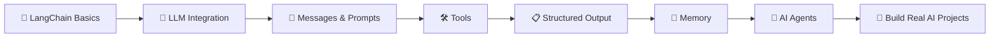

# 🦜🔗 LangChain Journey

<div align="center">

### 🚀 My Hands-On Journey to Learning LangChain

*Exploring the world of LLMs, AI Agents, Tools, Memory, and more — one notebook at a time.*

[](https://www.python.org/)
[](https://www.langchain.com/)
[]()
[]()

</div>

---

## 👋 Welcome!

Welcome to my **LangChain Journey**! 🎯

This repository documents my hands-on learning experience with **LangChain** and modern **Large Language Models (LLMs)**.

Instead of just reading about AI concepts, I believe the best way to learn is by **building and experimenting**. That's why this repository contains practical notebooks and projects covering different LangChain concepts.

> 💡 **Goal:** Learn → Experiment → Build → Improve 🚀

---

## 🧭 What I'm Learning

This repository explores several important concepts in the LangChain ecosystem:

| 🧠 Topic | 📚 What I'm Exploring |
|---|---|
| 🤖 **LLM Integration** | Connecting and working with language models |
| 🔗 **Model Integration** | Using different AI models in applications |
| 🛠️ **Tools** | Giving AI models access to useful tools |
| 💬 **Messages** | Understanding how AI conversations work |
| 📋 **Structured Output** | Getting organized and predictable responses |
| ⚙️ **Middleware** | Adding extra functionality to AI workflows |
| 🤖 **AI Agents** | Creating intelligent agents that can perform tasks |
| 🧠 **Memory** | Helping AI applications remember context |
| 🔌 **LLM APIs** | Working with language model APIs |
| 📖 **In-Context Learning** | Exploring how examples can improve model responses |

---

## 📂 Repository Structure

```text
LangChain-Journey/
│
├── 🤖 2-modelintegration.ipynb
│   └── Exploring model integration
│
├── 🛠️ 3-tools.ipynb
│   └── Learning how to use tools with LangChain
│
├── 💬 4-messages.ipynb
│   └── Understanding messages and conversations
│
├── 📋 5-structuredoutput.ipynb
│   └── Working with structured AI responses
│
├── ⚙️ 6-middleware.ipynb
│   └── Exploring middleware concepts
│
├── 📖 In-Context Learning...
│   └── Learning through examples and prompts
│
├── 🤖 create_agent.ipynb
│   └── Building an AI agent
│
├── 🔌 llm_API.py
│   └── Working with LLM APIs
│
└── 🧠 memory.ipynb
    └── Exploring memory in AI applications
```

---

## 🎯 My Learning Roadmap



---

## 🛠️ Technologies & Concepts

<p align="center">

🐍 **Python** &nbsp; • &nbsp;
🦜 **LangChain** &nbsp; • &nbsp;
🤖 **LLMs** &nbsp; • &nbsp;
🔌 **APIs** &nbsp; • &nbsp;
📓 **Jupyter Notebooks**

</p>

---

## 💡 Why This Repository?

The field of Generative AI is growing rapidly, and I wanted a place to document my learning journey.

This repository helps me:

- 📚 Keep track of everything I learn
- 🧪 Experiment with different LangChain features
- 💻 Build practical examples
- 🧠 Improve my understanding of AI systems
- 🚀 Prepare for building larger AI projects and agents

---

## 🚀 What's Next?

My journey is still in progress! Here are some areas I plan to explore further:

- [ ] Advanced AI Agents 🤖
- [ ] RAG Applications 📚
- [ ] Vector Databases 🗄️
- [ ] LangGraph Workflows 🔀
- [ ] Multi-Agent Systems 👥
- [ ] Real-World AI Applications 🌍

> **The journey has just begun! 🚀**

---

## 🌟 Learning Philosophy

```text
        📚 LEARN
           ↓
        🧪 EXPERIMENT
           ↓
        💻 BUILD
           ↓
        ❌ MAKE MISTAKES
           ↓
        🧠 LEARN AGAIN
           ↓
        🚀 GROW
```

---

## 🤝 Connect & Explore

If you're also learning **LangChain, Generative AI, or AI Agents**, feel free to explore this repository!

⭐ If you find this repository useful or interesting, consider giving it a star.

---

<div align="center">

### 💻 Learning AI, One Project at a Time

**⭐ Star the repository if you found it interesting!**

*“The best way to learn is to build.”* 🚀

---

**Thanks for visiting! 🙌**

</div>
